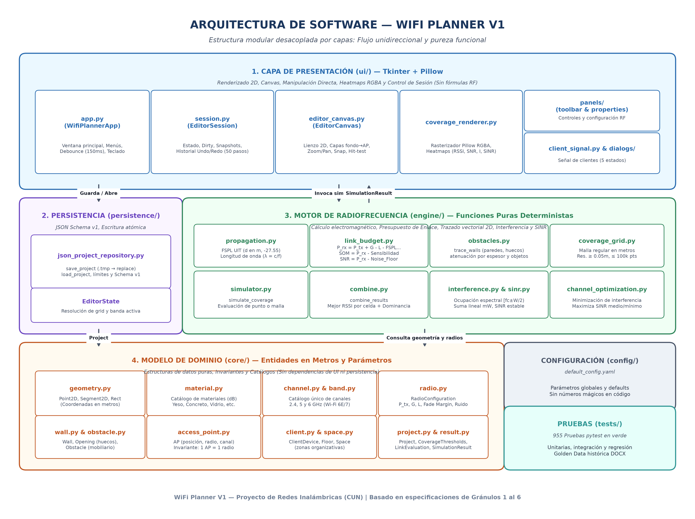
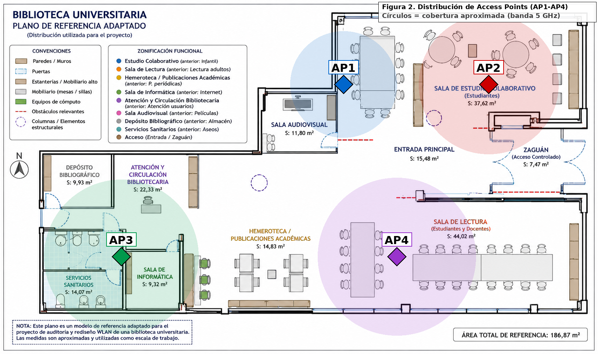

# WifiPlaner


Simulador y planificador de redes Wi-Fi para entornos interiores en 2D. Permite modelar espacios físicos a escala métrica, simular la propagación de radiofrecuencia (RF), analizar la cobertura mediante mapas de calor (*heatmaps*), evaluar la relación señal-a-interferencia-más-ruido (SINR) y optimizar la asignación de canales para puntos de acceso.

---

## 📌 Características principales

- **Modelado espacial 2D:** Creación y edición interactiva de pisos con dimensiones métricas reales, delimitación de espacios y zonas.
- **Paredes y atenuación por materiales:** Trazado de muros y aperturas asociadas a materiales normalizados (concreto, ladrillo, vidrio, madera) con cálculo de pérdidas RF por intersección geométrica.
- **Puntos de acceso y clientes:** Colocación de APs configurables (potencia de transmisión, ganancia, bandas de 2.4 GHz, 5 GHz y 6 GHz, canal y ancho de banda) y dispositivos cliente para evaluación puntual de enlace.
- **Motor de propagación RF puro:** Cálculo de pérdidas en espacio libre (FSPL), presupuesto de enlace (*link budget*), RSSI, margen de operación (SOM) y relación señal-a-ruido (SNR).
- **Mapas de calor interactivos:** Generación de matrices de cobertura (*CoverageGrid*) con renderizado de heatmaps continuos y leyendas de calidad.
- **Análisis de interferencia y SINR:** Modelado espectral de solapamiento co-canal y de canal adyacente para el cálculo de SINR en despliegues multi-AP.
- **Optimización de canales:** Algoritmo determinista para sugerir la mejor distribución de frecuencias minimizando la interferencia co-canal.
- **Persistencia e historial:** Guardado y carga de proyectos en formato JSON versionado (`schema_version=1`) y sistema de deshacer/rehacer (*undo/redo*) basado en gestos y *snapshots*.

---

## 🛠️ Tecnologías

- **Python (>= 3.10):** Lenguaje base del proyecto.
- **Tkinter / Canvas:** Interfaz gráfica nativa de escritorio con viewport métrico interactivo, zoom y paneo.
- **Pillow (PIL):** Renderizado de matrices de cobertura e interpolación visual de mapas de calor.
- **PyYAML:** Configuración centralizada de parámetros RF y constantes del sistema (`default_config.yaml`).
- **pytest:** Suite exhaustiva de pruebas unitarias y de integración (**955 tests passing**).

---

## 🏛️ Arquitectura

El sistema implementa una arquitectura modular con separación estricta de responsabilidades, garantizando que el motor matemático no dependa de la interfaz gráfica ni de la capa de persistencia:

```text
               ┌───────────────────────┐
               │          UI           │
               │ (Tkinter, Viewport,   │
               │  Renderers, Paneles)  │
               └───────────┬───────────┘
                           │ invoca
                           ▼
               ┌───────────────────────┐
               │    EditorSession      │
               │ (CRUD, Undo/Redo)     │
               └───────┬───────┬───────┘
                       │       │
         consume datos │       │ evalúa RF
                       ▼       ▼
    ┌──────────────────────┐  ┌──────────────────────┐
    │     Core / Domain    │  │        Engine        │
    │ (Geometría, Paredes, │  │ (FSPL, Link Budget,  │
    │  APs, Clientes, Esp) │  │  SINR, Optimización) │
    └──────────────────────┘  └──────────────────────┘
                       ▲
                       │ serializa / carga
               ┌───────┴───────────────┐
               │      Persistence      │
               │   (JSON Repository)   │
               └───────────────────────┘
```

### Reglas de diseño clave
1. `core/` y `engine/` son módulos de lógica pura; no importan Tkinter, PIL ni `ui/`.
2. `engine/` es determinista y no mantiene estado global.
3. La interfaz gráfica (`ui/`) no implementa cálculos de radiofrecuencia; delega directamente en `engine/`.

### Diagrama de componentes


*Estructura modular del simulador y flujo de componentes.*

### Plano de referencia


*Plano arquitectónico de prueba utilizado para calibración geométrica y validación de cobertura.*

---

## 📁 Estructura del repositorio

```text
WifiPlaner/
├── assets/          # Diagramas de arquitectura, planos base y referencias visuales
├── docs/            # Documentación técnica completa, manual de usuario y fórmulas RF
├── legacy/          # Prototipos históricos (v1–v4) desacoplados
├── wifi_planner/    # Código fuente modular, configuración y suite de pruebas
├── requirements.txt # Dependencias del proyecto
└── README.md        # Descripción general del proyecto
```

---

## 🚀 Instalación y uso

### Requisitos previos
- **Python 3.10** o superior instalado en el sistema.

### 1. Acceder al directorio del proyecto
```powershell
cd WifiPlaner
```

### 2. Instalar dependencias
```powershell
python -m pip install -r requirements.txt
```

### 3. Ejecutar la aplicación
```powershell
python wifi_planner/main.py
```

---

## 🧪 Pruebas automatizadas

El proyecto cuenta con una cobertura integral de pruebas que valida desde la geometría básica y las fórmulas de propagación hasta la persistencia y la respuesta ante ediciones interactivas.

Para ejecutar la suite completa de pruebas:

```powershell
python -m pytest
```

*(O ejecutando directamente sobre el paquete: `python -m pytest wifi_planner`)*

```text
======================== 955 passed in 18.64s ========================
```

---

## 📚 Documentación técnica

La documentación detallada se encuentra centralizada en la carpeta [`docs/`](docs/):

- [**docs/architecture.md**](docs/architecture.md): Detalle de las capas arquitectónicas, responsabilidades, contratos y flujo de datos.
- [**docs/formulas.md**](docs/formulas.md): Catálogo de los 15 bloques de fórmulas matemáticas y de radiofrecuencia utilizadas (FSPL, atenuación por paredes, SINR, interferencia).
- [**docs/decisions.md**](docs/decisions.md): Registro de decisiones de arquitectura y diseño técnico (99 ADRs documentados de la A a la CU).
- [**docs/technical_context.md**](docs/technical_context.md): Especificación técnica exhaustiva, requerimientos funcionales y estructuras de datos.
- [**docs/user_manual.md**](docs/user_manual.md): Manual de operación paso a paso para el usuario final, atajos de teclado y herramientas del lienzo.
- [**legacy/README.md**](legacy/README.md): Documentación de los prototipos tempranos y su desacoplamiento respecto a la versión actual.

---

## 📜 Prototipos históricos (Legacy)

El directorio [`legacy/`](legacy/) conserva los scripts iniciales correspondientes a las versiones v1 a v4 del proyecto. Estos archivos se mantienen con fines de trazabilidad histórica y verificación de cálculos iniciales, pero se encuentran **totalmente desacoplados** del simulador moderno y de su suite de pruebas.

---

## 👤 Autor

Proyecto desarrollado por **Jhonatan David** como parte de su portafolio de ingeniería de software y telecomunicaciones.
